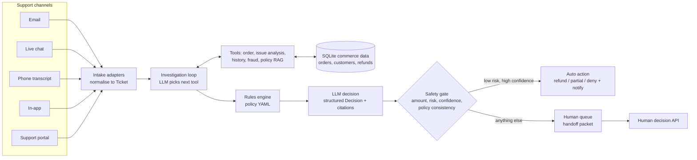

# ResolveAI

**Customer issues, resolved (safely).** An end-to-end AI agent that investigates, decides and
resolves refund requests across five support channels, and knows when to involve a human.

[](https://www.python.org/)
[](LICENSE)
[](https://github.com/Navyagowda2714/resolveai-refund-agent/actions/workflows/ci.yml)
[](https://github.com/astral-sh/ruff)

## Why this exists

Refund requests are the highest-volume, most repetitive work in e-commerce support, and they are
also where an over-eager AI agent costs real money. Most "AI support agent" demos show the happy
path; the hard part is everything around it: tickets arrive in five different shapes, policy has
windows and exceptions, some customers are abusing refunds, and some messages (a chargeback
threat, an overheating charger) must never be handled by a bot. ResolveAI is a reference
implementation of an agent that does the investigation work, proposes a structured decision with
policy citations, and only acts on its own when the decision is low-risk, high-confidence and
consistent with deterministic policy. Everything else goes to a human with a full handoff packet.

## Key features

- **Omnichannel intake**: adapters for email (strips quoted replies and signatures), live chat
  (multi-turn, customer turns only), phone transcripts (speaker labels, spoken digits such as
  "ORD one zero two..."), in-app reason codes with photos, and portal forms, all normalised into
  one `Ticket` model.
- **Tool-calling investigation loop**: the LLM picks tools one at a time from JSON-schema
  definitions: `fetch_order_details`, `analyze_issue`, `review_customer_history`,
  `run_fraud_checks`, `check_refund_policy`. It can stop early when escalation is certain, and a
  completeness guard always runs the minimum tools.
- **Policy as code**: refund windows per category, final-sale and non-refundable rules, restocking
  fees, in-transit grace, warranty handling and automation limits live in
  [`refund_policy.yaml`](src/resolveai/policy/refund_policy.yaml). The human-readable policy is
  indexed with BM25 so every decision carries `POL-x.y` citations.
- **Explainable fraud scoring**: refund frequency, refund rate, account age, amount vs. order
  history, billing/shipping country mismatch and "not received" claims that contradict carrier
  data. Every point in the score maps to a named signal.
- **Structured decisions + safety gate**: the LLM returns
  `Decision{action, amount, confidence, reasons, policy_citations}`. An independent gate only lets
  it execute when the amount is within policy and under the 150 EUR auto limit, fraud risk is
  low, confidence clears the threshold, and the fraud and policy tools actually ran.
- **Actions with real contracts**: an idempotent mock payments service (balance checks,
  idempotency keys), templated customer notifications, and a prioritised human queue with a
  handoff packet (reasoning summary, why escalated, AI proposal, findings, next steps).
- **FastAPI service + CLI**: `/tickets`, `/tickets/{id}/resolve`, `/queue`, `/queue/{id}/decision`;
  a `rich` CLI demo runs five showcase tickets end to end with readable traces.
- **Safety-first evaluation**: 80 labelled synthetic tickets, including a hard slice, measuring
  autonomous resolution, decision accuracy, **unsafe-approval rate**, escalation
  precision/recall, tool calls and simulated latency, with and without the safety gate.

## Architecture



1. An **intake adapter** turns the raw channel payload into a `Ticket`.
2. The **investigation loop** asks the LLM for the next tool call (JSON schema), executes it, and
   feeds the observation back until the model finishes or hits the tool budget.
3. The **rules engine** evaluates the policy deterministically: eligibility, refundable amount,
   mandatory escalations.
4. The **decision step** asks the LLM for a structured `Decision` given findings and the policy
   evaluation.
5. The **safety gate** decides whether that decision may run without a human. If yes, the payment,
   notification and ticket update happen; if not, the ticket is escalated with a handoff packet.

Deep dive: [docs/ARCHITECTURE.md](docs/ARCHITECTURE.md) (sequence diagrams, data model, ADRs,
failure modes).

## Quickstart

```bash
git clone https://github.com/Navyagowda2714/resolveai-refund-agent && cd resolveai-refund-agent
python -m venv .venv && source .venv/bin/activate
make install          # pip install -e ".[dev]"
make demo             # 5 showcase tickets, offline, no API key needed
make eval             # 80 labelled tickets -> evals/results.md
make test             # 34 tests
```

**Offline mode.** Without an API key, the LLM is replaced by `ScriptedLLM`, a deterministic
stand-in that plays the model's two roles (choosing the next tool, proposing a decision) with
transparent heuristics. It goes through the same prompt, JSON-parse and validation path as a real
provider, so the demo and evaluation exercise the full pipeline. Offline numbers measure the
pipeline, tools, rules and guardrails. They are **not** a measure of real-model reasoning
quality; that needs a run with a real model.

**Real LLM.**

```bash
pip install -e ".[anthropic]"            # or .[openai]
export LLM_PROVIDER=anthropic ANTHROPIC_API_KEY=sk-...
export LLM_MODEL=claude-sonnet-5-5       # optional; claude-haiku-5-5 for a cheaper run
resolveai demo && resolveai eval --out-dir evals/anthropic
```

`LLM_PROVIDER=openai` (default `gpt-4o-mini`) and `LLM_PROVIDER=ollama` (local `llama3.1`) work
the same way. If the selected provider's key is missing, the factory logs a warning and falls
back to offline mode.

**Docker.**

```bash
cp .env.example .env
docker compose up --build      # seeds SQLite and serves the API on :8000
```

## Usage

### CLI demo (real output, offline mode)

```text
$ make demo
╭── Live chat: one item missing from a 3-item order  (chat, TKT-F675E6EA9E) ───╮
│   #  step        detail                                                      │
│   1  intake      chat ticket from luca.bianchi@example.com                   │
│   2  thought     Start by fetching the order the customer is asking about.   │
│   3  tool_call   fetch_order_details: order ORD-90005 (delivered, 2d since   │
│                  delivery, refundable 187.00)                                │
│   4  thought     Classify the issue and check which items are affected.      │
│   5  tool_call   analyze_issue: issue=missing_item conf=0.85                 │
│                  items=['EL-130'] triggers=-                                 │
│   6  thought     Check the refund policy for electronics / missing_item.     │
│   7  tool_call   check_refund_policy: window=30d, sections=['POL-3.4',       │
│                  'POL-2.2', 'POL-3.3']                                       │
│   8  thought     Review the customer's order and refund history.             │
│   9  tool_call   review_customer_history: account 400d, 3 orders, 0          │
│                  refunds/90d                                                 │
│  10  thought     Run fraud checks before any money moves.                    │
│  11  tool_call   run_fraud_checks: score=0 (low) no signals                  │
│  12  thought     I have enough evidence to decide.                           │
│  13  rules       policy -> partial_refund 39.00                              │
│  14  decision    model proposes partial_refund 39.00 (confidence 0.85)       │
│  15  guardrail   automate                                                    │
│  16  action      refunded 39.00 EUR (PAY-4FEF517186); customer notified      │
╰──────────────────────────────────────────────────────────────────────────────╯
...
┏━━━━━━━━━━━━━━━━━━━━━━━━━━━━┳━━━━━━━━━┳━━━━━━━━━━━━━━━┳━━━━━━━━┳━━━━━━┳━━━━━━━┓
┃ ticket                     ┃ channel ┃ outcome       ┃ amount ┃ conf ┃ tools ┃
┡━━━━━━━━━━━━━━━━━━━━━━━━━━━━╇━━━━━━━━━╇━━━━━━━━━━━━━━━╇━━━━━━━━╇━━━━━━╇━━━━━━━┩
│ Email: cracked dinner set, │ email   │ auto_approved │ 64.00  │ 0.99 │ 5     │
│ photo attached             │         │               │        │      │       │
│ Live chat: one item        │ chat    │ auto_partial  │ 39.00  │ 0.85 │ 5     │
│ missing from a 3-item      │         │               │        │      │       │
│ order                      │         │               │        │      │       │
│ Phone: 1,149 EUR laptop    │ phone   │ escalated     │ 0.00   │ 0.85 │ 5     │
│ won't turn on              │         │               │        │      │       │
│ In-app: 'never arrived' on │ in_app  │ escalated     │ 0.00   │ 0.90 │ 5     │
│ a brand-new account        │         │               │        │      │       │
│ Portal: change of mind, 40 │ portal  │ auto_denied   │ 0.00   │ 0.97 │ 3     │
│ days after delivery        │         │               │        │      │       │
└────────────────────────────┴─────────┴───────────────┴────────┴──────┴───────┘

Human queue: 2 open escalation(s)
  ESC-79E05B41  Customer reports 'defective' (classifier confidence 0.85).
Policy evaluation: approve_refund of 1149.00. AI proposed approve_refund 1149.00
at confidence 0.85. Escalated because: amount_above_auto_limit.
  ESC-71DB6402  Customer reports 'not_received' (classifier confidence 0.85).
Policy evaluation: escalate. AI proposed escalate at confidence 0.90. Escalated
because: carrier confirms delivery: carrier dispute; fraud risk medium (58):
new_account, address_mismatch, delivery_contradiction.
```

The chat customer mentions three products, but only the hub "wasn't in the box": the analyser
attributes the issue to the item in the same clause as the evidence, so only 39.00 is refunded.
The portal ticket stops after 3 tools because it is outside the 14-day beauty window; no fraud
check is needed to say no.

### REST API

```bash
make serve   # seeds data/resolveai.db, writes showcase payloads, serves on :8000
curl -s -X POST localhost:8000/tickets -H 'content-type: application/json' \
  -d '{"channel": "email", "payload": '"$(cat examples/payloads/email_damaged.json)"'}'
curl -s -X POST localhost:8000/tickets/TKT-.../resolve
curl -s localhost:8000/queue
curl -s -X POST localhost:8000/queue/ESC-.../decision -H 'content-type: application/json' \
  -d '{"action": "approve_refund", "amount": 1149, "agent": "agent-7", "notes": "photos verified"}'
```

Output of [`examples/http_walkthrough.py`](examples/http_walkthrough.py) against the seeded server
(the script plays the human for both queue items):

```text
TKT-9A85ADCF16 email   -> auto_approved     64.00
TKT-F675E6EA9E chat    -> auto_partial      39.00
TKT-D7D7BE0904 phone   -> escalated          0.00
TKT-A3962F3D40 in_app  -> escalated          0.00
TKT-DBC19C5F4B portal  -> auto_denied        0.00

2 ticket(s) waiting for a human

ESC-B601014F [high] Customer reports 'defective' (classifier confidence 0.85). Policy evaluation: approve_refund of 1149.00. AI proposed approve_refund 1149.00 at confidence 0.85. Escalated because: amount_above_auto_limit.
next steps: ["Amount above automation limit: approve manually if evidence holds."]
human decision -> {'escalation_id': 'ESC-B601014F', 'action': 'approve_refund', 'amount': 1149.0, 'refund_id': 'PAY-22D1F68C95'}

ESC-B9C01DF6 [high] Customer reports 'not_received' (classifier confidence 0.85). Policy evaluation: escalate. AI proposed escalate at confidence 0.90. Escalated because: carrier confirms delivery: carrier dispute; fraud risk medium (58): new_account, address_mismatch, delivery_contradiction.
next steps: ["Open a trace with the carrier and request proof-of-delivery photo.", "Verify identity / review fraud signals before refunding."]
human decision -> {'escalation_id': 'ESC-B9C01DF6', 'action': 'deny', 'amount': 0.0}
```

### Python

```python
from resolveai.data.db import CommerceDB
from resolveai.service import ResolveService

service = ResolveService(CommerceDB("data/resolveai.db"))
ticket = service.ingest(
    "phone",
    {
        "account_email": "aisha.khan@example.com",
        "transcript": "CUSTOMER: my laptop won't turn on ...",
    },
)
resolution = service.resolve(ticket.id)
print(resolution.outcome, resolution.proposed.policy_citations, resolution.escalation_id)
```

## Evaluation

`make eval` runs 80 labelled synthetic tickets (18 approve, 15 partial, 16 deny, 31 escalate; 12
deliberately hard), once with the safety gate and once with it disabled. Labels encode what a
careful senior agent would do and are written per scenario, not derived from the rules engine.
Numbers below are copied from [`evals/results.md`](evals/results.md) and were produced **in
offline mode** (`ScriptedLLM` + lexicon issue analyser). Latency is simulated: modelled tool
latencies plus a modelled per-LLM-call latency.

| Metric | With safety gate | Gate disabled (ablation) |
|---|---|---|
| Resolved autonomously | 62.5% | 78.8% |
| Decision accuracy (action + amount) | 92.5% | 81.2% |
| Accuracy of automated decisions | 92.0% | 76.2% |
| **Unsafe approvals** (refund issued when label is deny/escalate) | **4 / 80 (5.0%)** | 15 / 80 (18.8%) |
| Unsafe-approval rate among tickets that should be denied/escalated | 8.5% | 31.9% |
| Escalation precision | 93.3% | 100.0% |
| Escalation recall | 90.3% | 54.8% |
| Hard-subset accuracy (12 tickets) | 40.0% | 60.0% |
| Avg tool calls / ticket | 4.53 | 4.53 |
| Avg simulated latency / ticket | 5.57 s (0.57 s tools) | same |

How to read this:

- The gate trades about 16 points of autonomy for cutting unsafe approvals from 15 to 4. Without
  it, the agent auto-refunds 899 EUR cameras and serial refunders.
- All 4 remaining unsafe approvals are in the hard slice: a chargeback threat phrased as "ask my
  card issuer to claw the money back", a "scorch mark" safety hazard, a "solicitor", and a
  customer who admits wearing the shoes for three weeks. The lexicon analyser misses these; a
  real LLM reading the raw text in the decision step is the intended fix. That is exactly what a
  model run should measure.
- The 2 partial-refund misses are mixed-signal tickets (dented box + late delivery) that the gate
  escalated for low confidence: a safe failure.

Methodology, metric definitions and the full error table are in
[docs/EVALUATION.md](docs/EVALUATION.md).

## Design decisions & trade-offs

- **Rules engine and LLM are separate, and the gate trusts neither alone.** Policy facts (windows,
  amounts) are deterministic and testable; the LLM handles language, ambiguity and explanation.
  The gate needs both to agree before money moves. *Trade-off:* some autonomy is lost on tickets
  where the model is right but the rules are conservative.
- **Escalate, never silently correct.** If the model proposes more than policy allows, the gate
  escalates instead of clipping the amount: a disagreement between model and policy is a signal
  a human should see.
- **Different thresholds for deny and approve.** Denials are customer-facing and harder to undo
  (0.85 vs 0.80 confidence), and a deny needs an explicit policy basis.
- **Provider-agnostic JSON tool calling.** Tool selection uses a JSON-schema "next action" contract
  instead of a provider's native tool API, so Anthropic, OpenAI, Ollama and the offline stand-in
  share one code path. *Trade-off:* one extra parse/validate step; native tool use would be a
  small provider-specific optimisation.
- **SQLite + idempotency keys.** The mock PSP enforces the same invariants as a real one (no
  double refunds, never above the remaining balance), so even with the gate disabled, the ablation
  test shows the payment layer refusing a 500 EUR refund on a 33.99 EUR order.
- **Lexicon issue analyser as a tool.** Transparent and auditable (it lists its evidence phrases),
  but brittle on paraphrase. The evaluation's hard slice exists to show that honestly.

## Project structure

```text
resolveai/
├── src/resolveai/
│   ├── intake/adapters.py        # email, chat, phone, in-app, portal -> Ticket
│   ├── tools/                    # registry (JSON schemas), analyzer, fraud, typed schemas
│   ├── policy/                   # refund_policy.yaml, refund_policy.md, rules engine, BM25
│   ├── agent/                    # investigation loop, decision, safety gate, offline policy
│   ├── actions/services.py       # mock payments, notifications, human queue
│   ├── data/                     # SQLite repository + synthetic data generator
│   ├── llm/                      # LLMClient protocol, Anthropic/OpenAI/Ollama, ScriptedLLM
│   ├── evaluation/               # labelled dataset generator, runner, metrics
│   ├── service.py api.py cli.py demo.py render.py
├── tests/                        # 34 pytest tests, no network
├── evals/                        # labelled_tickets.jsonl, results.json, results.md
├── examples/                     # python_api.py, http_walkthrough.py, payloads/
├── docs/ARCHITECTURE.md  docs/EVALUATION.md
└── Makefile  Dockerfile  docker-compose.yml  pyproject.toml
```

## Roadmap

- Run the evaluation against Claude and GPT models and publish per-model numbers next to the
  offline baseline, with cost per resolved ticket.
- Replace the lexicon `analyze_issue` with an LLM or small classifier (keeping the lexicon as a
  cheap first pass), aimed at the hidden-trigger failures above.
- Real vision captions through the `ImageDescriber` hook (currently uses channel alt text).
- Confidence calibration on human-labelled outcomes from the queue (feedback loop from
  `/queue/{id}/decision`).
- Postgres + an outbox for notifications; OpenTelemetry spans for each trace step.

## License

MIT, see [LICENSE](LICENSE).

Built by [Navyashree Byregowda](https://www.linkedin.com/in/navyashree-byregowda-472821196/)
